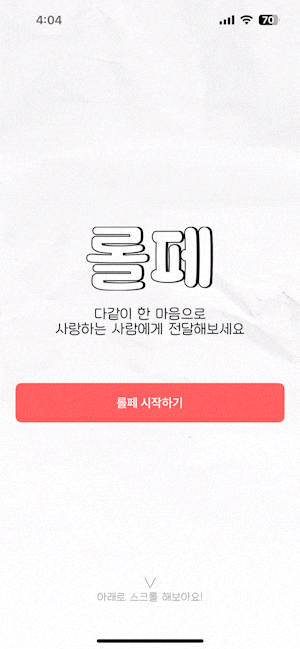
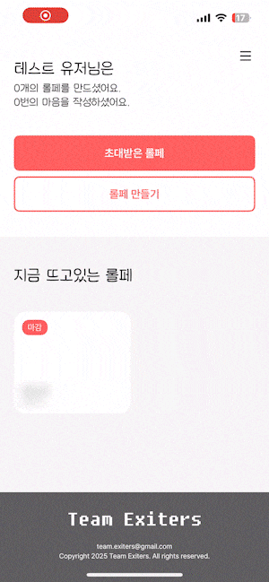
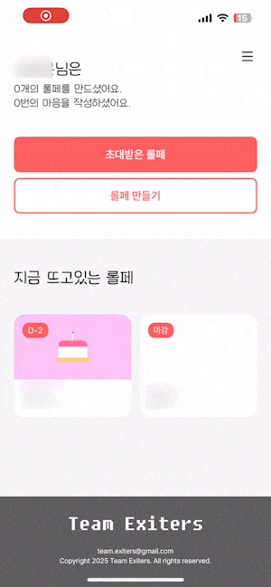
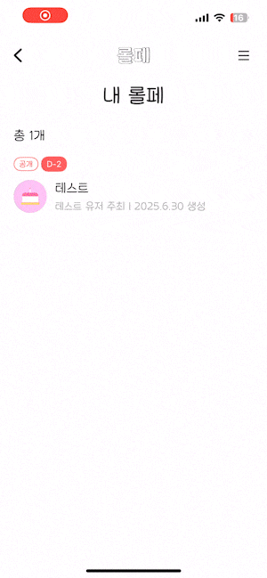
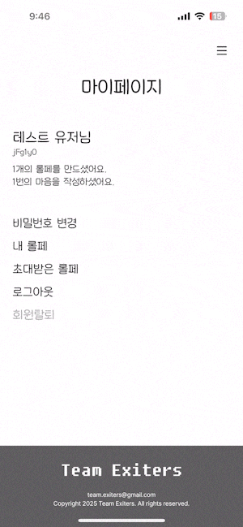

<h1 align="center">
  롤페
</h1>

  
   
   
  다같이 한 마음으로 사랑하는 사람에게 전달해보세요.

 

  
  

## 소개

더 이상 종이와 펜을 사용하지 마세요! '롤페' 앱 하나면 언제 어디서든 롤링페이퍼를 만들어 전달할 수 있습니다! 
친구의 생일, 직장 동료의 송별회, 스승의 날 감사 인사, 졸업, 결혼 등 특별한 날 
지금 바로 '롤페'를 다운로드하고 사랑하는 사람에게 마음을 전달하세요! 
 
 
[롤페 사용법] 
 

  1. 롤페 만들기: 제목, 테마, 마감일, 수신자를 설정하여 롤페를 만드세요. 
  2. 공유하기: 롤페를 공유하여 사람들을 초대하세요. 
  3. 마음 남기기: 메모지를 눌러 마음을 남기세요. 
  4. 전달하기: 마감일이 지나면 수신자에게 자동으로 전달이 돼요. 이미지로도 저장할 수 있어요! 

 
 

## 기능

<table>
  <tr>
    <td align="center">
      
    </td>
  </tr>
  <tr>
    <td align="center"><b>롤페 만들기</b></td>
  </tr>
</table>

<table>
  <tr>
    <td align="center">
      
    </td>
  </tr>
  <tr>
    <td align="center"><b>검색 후 입장</b></td>
  </tr>
</table>

<table>
  <tr>
    <td align="center">
      
    </td>
  </tr>
  <tr>
    <td align="center"><b>마음 남기기</b></td>
  </tr>
</table>

<table>
  <tr>
    <td align="center">
      
    </td>
  </tr>
  <tr>
    <td align="center"><b>롤페 마감 후 이미지 저장</b></td>
  </tr>
</table>

## React Native 버전에서 추가된 기능

- Android 지원 (Google Play 출시)
- 초대 링크를 누르면 앱의 해당 롤페로 바로 이동 (iOS Universal Links, Android App Links)
- 로그인 전에 받은 초대는 로그인 후 이어서 열기
- 롤페 방장 권한: 참여자 관리, 초대, 내보내기
- 마음 수정 이력 확인
- 부적절한 콘텐츠 신고와 사용자 차단
- 1:1 문의와 공지사항

## 기여자

<table>
  <tr>
    <td align="center">
      
    </td>
  </tr>
  <tr>
    <td align="center">
      <a href="https://github.com/hugesilver">hugesilver</a>
    </td>
  </tr>
</table>

## 기술 스택

   

## 외부 패키지

- [Expo SDK 58](https://github.com/expo/expo) (Expo Router, Expo Image, SecureStore, Apple Authentication 등)
- [React Native Kakao Login](https://github.com/crossplatformkorea/react-native-kakao-login)
- [Google Sign-In for React Native](https://github.com/react-native-google-signin/google-signin)
- [Axios](https://github.com/axios/axios)
- [i18next](https://github.com/i18next/i18next), [react-i18next](https://github.com/i18next/react-i18next)
- [React Native Reanimated](https://github.com/software-mansion/react-native-reanimated)
- [React Native Gesture Handler](https://github.com/software-mansion/react-native-gesture-handler)
- [React Native WebView](https://github.com/react-native-webview/react-native-webview)
- [React Native View Shot](https://github.com/gre/react-native-view-shot)
- [React Native DateTimePicker](https://github.com/react-native-datetimepicker/datetimepicker)
- [html-to-image](https://github.com/bubkoo/html-to-image)
